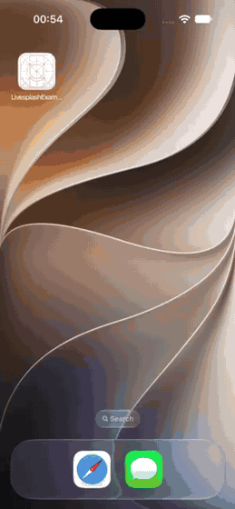
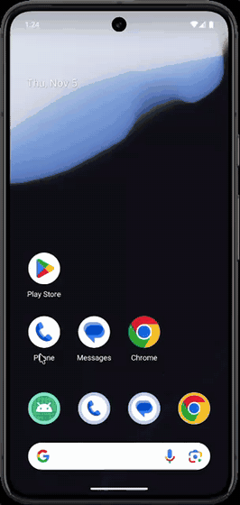

# react-native-splash-motion — React Native Splash Screen with Lottie Animation

**An animated React Native splash screen with Lottie & dotLottie — rendered natively, _before_ your JavaScript loads.**

Most "animated splash" solutions render the animation with React, so it can only start once the JS bundle has loaded. Until then your users stare at a static image. SplashMotion plays your animation in a native view from the very first frames of app launch, keeps it running **while** the bundle loads, and hands off to your app with a polished outro.

- 🎬 **Lottie or dotLottie** — bring the file your designer exported (`.json` or `.lottie`)
- ⚡ **Native from frame one** — Core Animation on iOS, off-main-thread rendering on Android
- 🪄 **Zero native code** — no `AppDelegate` / `MainActivity` edits, it wires itself up
- 🧩 **Expo & bare React Native** — config plugin + CLI share the same generator
- 🔥 **New Architecture only**, built on [Nitro Modules](https://nitro.margelo.com)
- 🎯 **Smart exit** — finishes the current loop, plays your outro, then fades

## Demo

<table>
  <tr>
    <th>iOS</th>
    <th>Android</th>
  </tr>
  <tr>
    <td></td>
    <td></td>
  </tr>
</table>

What you're seeing, from the tap on the app icon:

1. **The OS launch screen** shows your background color straight away, before any of your code runs.
2. **The animation plays natively** while React Native starts and your JavaScript loads in the background.
3. **Your app calls `hide()`** once it's ready. The current loop finishes, then the splash fades out to reveal the app.

Both recordings are release builds of the [example app](example/), with the splash generated by:

```sh
npx splash-motion generate assets/splash.json --background "#0F6E56" --width 160
```

## Requirements

- React Native with the **New Architecture** enabled (the default since 0.76)
- [`react-native-nitro-modules`](https://github.com/mrousavy/nitro)
- iOS 15+ · Android 7+ (API 24)
- Expo: a development build (Expo Go can't load custom native code)

## Installation

```sh
yarn add react-native-splash-motion react-native-nitro-modules
```

## Your animation file

Put the file anywhere in your project (e.g. `assets/splash.json`) and point the CLI or Expo plugin at it. The format is picked from the extension:

| Format    | Extension | Where it comes from                                                 |
| --------- | --------- | ------------------------------------------------------------------- |
| Lottie    | `.json`   | After Effects + Bodymovin, or "Lottie JSON" download on LottieFiles |
| dotLottie | `.lottie` | "dotLottie" download on LottieFiles, or any dotLottie v1/v2 export  |

- **`.lottie`** files are unpacked at build time into plain Lottie JSON. Images bundled inside are embedded, so they render as-is. If the file contains several animations, the active one (or the first) is used.
- The animation is copied into the native project when you run the generator, so after replacing the file, run it again and rebuild.

See [Designing your animation](#designing-your-animation) for markers (`loop`, `outro`) and other tips.

### Size

The animation is drawn at a fixed size, centered on the splash background. Sizes are in points on iOS and dp on Android.

| Option     | Default                                                   |
| ---------- | --------------------------------------------------------- |
| `--width`  | `160`                                                     |
| `--height` | Follows the animation's own aspect ratio (its `w` / `h`). |

Both must be positive numbers; decimals are fine. There is no upper limit, but at runtime the animation is **scaled down to fit 90% of the screen's width and height**, keeping its aspect ratio, so a large value never gets cut off (on phones, in landscape or in split-screen). It is never scaled up, so on tablets it stays at the size you set. The iOS launch-screen `--still` image follows the same rule, so the hand-off doesn't jump.

### First frame on the launch screen (`--still`)

Before your app's process is running, no code can play an animation: iOS shows its launch storyboard and Android its system splash, both static. Without a still, that moment shows only the background color. Pass a PNG of your animation's **first frame** (transparent background, ideally at 3× or 4× the size you set) and the CLI puts it on both launch screens at exactly the place and size of the animation, so the animation looks like it is there from the first tap and simply starts moving:

```sh
npx splash-motion generate assets/splash.json --background "#0F6E56" --still assets/splash-first-frame.png
```

Export the frame from After Effects or LottieFiles. With `--loop-marker`, use the first frame of that marker instead, since that's where playback starts. Automatic extraction (no PNG needed) is on the [roadmap](#roadmap); for now the PNG has to come from you.

On Android the system splash only shows a centered circle 192dp wide, so keep the first frame's artwork inside that circle (or use a width of about 135dp or less to show all of it). Anything outside it appears as soon as the animation takes over.

### Bare React Native

Generate the splash from your animation, then rebuild:

```sh
npx splash-motion generate assets/splash.json --background "#0F6E56"
cd ios && pod install
```

That's it — there is no native code to add.

### Expo

Remove `expo-splash-screen` (SplashMotion replaces it), then add the plugin:

```json
{
  "expo": {
    "plugins": [
      [
        "react-native-splash-motion",
        {
          "source": "./assets/splash.json",
          "background": "#0F6E56",
          "width": 200
        }
      ]
    ]
  }
}
```

```sh
npx expo prebuild --clean
```

## Usage

Hide the splash once your app is ready:

```tsx
import SplashMotion from 'react-native-splash-motion';

<NavigationContainer onReady={() => SplashMotion.hide()}>
  {/* … */}
</NavigationContainer>
```

Or with the hook:

```tsx
import { useHideSplash } from 'react-native-splash-motion';

function App() {
  const [fontsLoaded] = useFonts(fonts);
  useHideSplash(fontsLoaded, { outro: 'outro' });
  // …
}
```

## API

### `hide(options?): Promise<void>`

Resolves once the splash is fully gone. All options are optional.

| Option        | Default | Description                                                              |
| ------------- | ------- | ------------------------------------------------------------------------ |
| `waitForLoop` | `true`  | Let the current loop finish instead of cutting the animation mid-motion. |
| `outro`       | —       | A **marker** name to play before leaving.                                |
| `minDuration` | `0`     | Keep the splash visible at least this long (ms since launch).            |
| `fade`        | `220`   | Fade-out duration in ms. `0` disables it.                                |

Order of events: `minDuration` → finish loop → `outro` → `fade`.

### `isVisible(): boolean`

### `useHideSplash(ready?: boolean, options?)`

Calls `hide(options)` as soon as `ready` is `true`.

## CLI

```
npx splash-motion generate <animation> [options]

  <animation>               A Lottie .json or a dotLottie .lottie file

  --background <hex>        Background color              (default: #FFFFFF)
  --width <number>          Animation width in dp/pt      (default: 160)
  --height <number>         Animation height in dp/pt     (default: keeps aspect ratio)
                            Scaled down at runtime to fit 90% of the screen
  --still <png>             Your animation's first frame, shown by the launch screen (iOS + Android)
  --loop-marker <name>      Only loop this marker's range
  --no-loop                 Play once and hold the last frame
  --keep-background         Keep a full-canvas background solid in the animation (removed by default)
  --platforms <list>        ios,android                   (default: both)
```

The Expo plugin accepts the same options in camelCase (`loopMarker`, `keepBackground: true`, …) plus `source`.

### Background layers

Animations exported from After Effects often include a full-size background solid (e.g. a white "White Solid 1" layer). It would draw an opaque box over your splash color, so the CLI removes it automatically and logs what it removed. Only plain, fully opaque solids at the bottom of the layer stack that cover the whole canvas are removed. Shapes, images and anything animated, masked or used as a matte are left alone. Pass `--keep-background` to keep it.

## Designing your animation

Add markers in After Effects (or LottieFiles):

- `loop` → the section that repeats while the app loads (`--loop-marker loop`)
- `outro` → the exit, played by `hide({ outro: 'outro' })`

Design frame 0 to sit on the same background color as your splash so the launch is seamless.

## How it works

```
Tap icon ─▶ OS launch screen ─▶ native overlay (animation playing) ─▶ hide() ─▶ outro ─▶ your app
            (static, generated)   └── JS bundle loads in parallel ──┘
```

1. **Build time** — the CLI / Expo plugin copies your animation (unpacking a `.lottie` to JSON) into the app's asset catalog (iOS) and `assets/` (Android), generates a matching launch screen and theme, and records the config.
2. **Launch** — the OS shows the static launch screen. SplashMotion installs itself automatically (`+load` on iOS, an init `ContentProvider` on Android), attaches a native overlay to the first window and starts the animation. On Android the animation is parsed in the background as soon as the process starts, and the system splash is held until its first frame is ready; the animation then starts from that frame, so the hand-off from the `--still` image is invisible.
3. **JS ready** — `hide()` goes through Nitro straight to Swift/Kotlin, which runs the exit sequence and removes the overlay.

## Testing

```js
// jest.setup.js
jest.mock('react-native-splash-motion', () => ({
  __esModule: true,
  default: {
    hide: jest.fn().mockResolvedValue(undefined),
    isVisible: jest.fn(() => false),
  },
  useHideSplash: jest.fn(),
}));
```

## Troubleshooting

- **Nothing changed** — native assets only update on a rebuild. Re-run `pod install` and rebuild; a JS reload isn't enough.
- **iOS shows the old launch screen, then the new background** — iOS caches a snapshot of the launch screen and only refreshes it when the app is reinstalled. Delete the app from the device or simulator (or run `xcrun simctl uninstall booted <bundle id>`), then build again.
- **Expo shows the old splash** — make sure `expo-splash-screen` is removed, then `npx expo prebuild --clean`.

## Roadmap

- Automatic first-frame extraction for `--still`
- Dark-mode background (`--dark-background`) that stays seamless on iOS too
- Per-platform animations and sizes
- Rive (`.riv`) animation support

## Contributing

See the [contributing guide](CONTRIBUTING.md). After changing `src/SplashMotion.nitro.ts`, run `yarn nitrogen`.

## License

MIT
